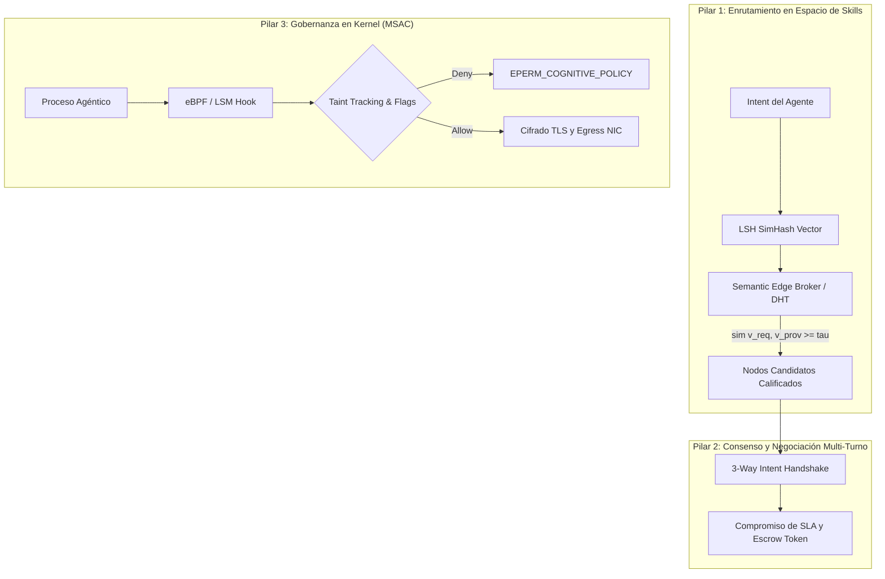
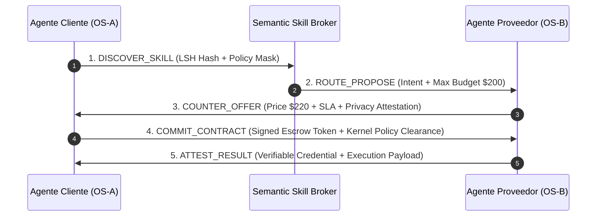
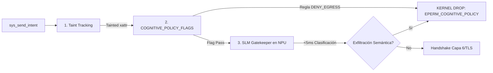

# Extensión del Modelo OSI: Capa 8 de Interacción Semántica y Gobernanza Agéntica (ILP)

[](Paper%20de%20Referencia%20-%20Capa%208%20de%20Interaccion%20OSI%20(ILP).pdf)
[](#)
[](LICENSE-DOCS)
[](LICENSE)
[-red.svg)](Paper%20de%20Referencia%20-%20Capa%208%20de%20Interaccion%20OSI%20(ILP).pdf)

> **Documento de Trabajo Formal:** `RFC-ILP-2026` / `ISO-7498-8 Draft`  
> **Área:** Arquitectura de Redes Cognitivas & Sistemas Agénticos  
> **Documento de Referencia Original:** [`Paper de Referencia - Capa 8 de Interaccion OSI (ILP).pdf`](Paper%20de%20Referencia%20-%20Capa%208%20de%20Interaccion%20OSI%20(ILP).pdf)

---

## Tabla de Contenidos

- [Resumen Ejecutivo (Abstract)](#resumen-ejecutivo-abstract)
- [1. Auditoría Arquitectónica: El Límite Estructural de la Capa 7](#1-auditoría-arquitectónica-el-límite-estructural-de-la-capa-7)
  - [El Paradigma de Acoplamiento Sintáctico Previo](#el-paradigma-de-acoplamiento-sintáctico-previo)
  - [Dictamen de Ingeniería: Corrección de Premisas](#dictamen-de-ingeniería-corrección-de-premisas)
- [2. Definición Formal de la Capa 8 (Capa de Interacción)](#2-definición-formal-de-la-capa-8-capa-de-interacción)
- [3. Posicionamiento en la Pila OSI Extendida y Comparativa Histórica](#3-posicionamiento-en-la-pila-osi-extendida-y-comparativa-histórica)
  - [La Pila OSI Extendida (L1–L8)](#la-pila-osi-extendida-l1l8)
- [4. Arquitectura de Encapsulamiento: Formato de Cabecera I-PDU](#4-arquitectura-de-encapsulamiento-formato-de-cabecera-i-pdu)
  - [Estructura Binaria de 256 bits (32 Bytes Fijos)](#estructura-binaria-de-256-bits-32-bytes-fijos)
  - [Desglose Detallado de Campos](#desglose-detallado-de-campos)
- [5. Los Tres Pilares Operativos](#5-los-tres-pilares-operativos)
  - [5.1. Enrutamiento en el Espacio de Skills (Semantic Anycast Routing)](#51-enrutamiento-en-el-espacio-de-skills-semantic-anycast-routing)
  - [5.2. Protocolo de Negociación y Consenso (3-Way Intent Handshake)](#52-protocolo-de-negociación-y-consenso-3-way-intent-handshake)
- [6. Inyección de Reglas de Usuario: El Firewall Cognitivo en el Kernel](#6-inyección-de-reglas-de-usuario-el-firewall-cognitivo-en-el-kernel)
  - [Mecanismo de Intercepción Obligatoria (MSAC)](#mecanismo-de-intercepción-obligatoria-msac)
- [7. Posicionamiento frente al Estado del Arte (2024–2026)](#7-posicionamiento-frente-al-estado-del-arte-20242026)
- [8. Vector de Amenazas Cognitivas y Mitigación por Diseño](#8-vector-de-amenazas-cognitivas-y-mitigación-por-diseño)
- [Estructura del Proyecto y Hoja de Ruta](#estructura-del-proyecto-y-hoja-de-ruta)
- [Prototipo de Referencia en Rust e Instrucciones de Prueba](#prototipo-de-referencia-en-rust-e-instrucciones-de-prueba)
  - [Ejecución de Pruebas](#ejecución-de-pruebas)
  - [Demostrador CLI](#demostrador-cli)
- [Licenciamiento](#licenciamiento)
- [Cita del Documento](#cita-del-documento)

---

## Resumen Ejecutivo (Abstract)

El modelo de interconexión de sistemas abiertos (**OSI, ISO/IEC 7498-1**) y la pila TCP/IP fueron concebidos bajo una premisa determinista: la transferencia confiable de secuencias de bits y estructuras sintácticas entre nodos pasivos cuyos contratos de interfaz han sido codificados estáticamente por humanos. 

La emergencia de agentes autónomos impulsados por modelos fundacionales (**LLMs/LAMs**) con razonamiento latente rompe este supuesto. Aunque protocolos de Capa 7 como HTTP/3 o gRPC transportan cargas útiles de forma eficiente, carecen de primitivas nativas para el **descubrimiento semántico de capacidades (*skills*)**, la **negociación multi-turno de intenciones** y la **aplicación obligatoria de políticas de privacidad cognitiva**. 

Este documento y repositorio evalúan críticamente la viabilidad de introducir una **Capa 8 de Interacción (*Interaction Layer Protocol, ILP*)**, demostrando que su implementación es técnicamente factible como una capa de abstracción semántica acoplada al subsistema de red del Sistema Operativo, y establece su especificación de referencia formal.

---

## 1. Auditoría Arquitectónica: El Límite Estructural de la Capa 7

### El Paradigma de Acoplamiento Sintáctico Previo

En la arquitectura de redes clásica:
- **Capa 6 (Presentación):** Resuelve la sintaxis (serialización JSON, Protobuf, compresión, cifrado TLS).
- **Capa 7 (Aplicación):** Resuelve la transferencia de estado representacional (HTTP, SMTP, MQTT, DNS).

Ambas capas operan bajo el paradigma de **Acoplamiento Sintáctico Previo**: el cliente debe conocer de antemano el esquema exacto del servidor (URI, verbos HTTP, métodos RPC, tipos de datos fuertemente tipados). Carecen por completo de mecanismos a nivel de protocolo de red para:
1. Negociar objetivos ambiguos en lenguaje natural o representaciones vectoriales.
2. Descubrir agentes dinámicamente según sus competencias cognitivas comprobables.
3. Verificar criptográficamente si la inferencia resultante infringe restricciones éticas o directivas de privacidad inyectadas por el usuario.

### Dictamen de Ingeniería: Corrección de Premisas

El análisis formal de viabilidad establece tres correcciones estrictas de ingeniería de sistemas requeridas para la estandarización real (IETF/ISO):

1. **Ubicación Topológica Real:**  
   No es viable ni deseable que los enrutadores de núcleo de red (*core routers* BGP/MPLS de Capa 3) inspeccionen la Capa 8 debido a la sobrecarga y latencia de inferencia. La Capa 8 opera estrictamente **Extremo a Extremo (*End-to-End*)** y en **Gateways de Borde Semántico (*Semantic Edge Brokers*)**, apoyándose sobre el transporte QUIC/HTTP-3 subyacente.

2. **Separación de Plano de Control vs. Plano de Inferencia:**  
   El encabezado de Capa 8 no puede ser texto libre evaluado por un LLM en cada salto intermedio. Debe consistir en una **estructura binaria determinista alineada a 32 bits** con vectores de intención precomputados (*embeddings cuantizados / SimHash*) que permitan filtrado y enrutamiento en microsegundos ($O(1)$).

3. **Intercepción Pre-TLS en el Espacio de Kernel:**  
   Para que las reglas y soberanía del usuario impidan fugas de datos (PII médico, financiero, biometría) antes de alcanzar la tarjeta de red (NIC), el módulo de Capa 8 debe ejecutarse como un demonio privilegiado del Sistema Operativo acoplado a hooks **eBPF / LSM** antes del cifrado de Capa 6.

---

## 2. Definición Formal de la Capa 8 (Capa de Interacción)

Se define formalmente la **Capa 8 (*Interaction Layer — ILP*)** como el nivel de abstracción superior a la Capa de Aplicación encargado de:

$$\mathcal{L}_8: \text{Intención Declarativa} \times \text{Políticas de Usuario} \longrightarrow \text{Secuencia Verificable de Ejecución Distribuida}$$

Mientras la **Capa 7** responde a la pregunta:
> *«¿A qué endpoint URI y puerto envío este payload sintáctico?»*

La **Capa 8** responde a:
> *«¿Qué capacidad (*skill*) de la red puede satisfacer este objetivo semántico bajo mis restricciones de gobernanza, soberanía y presupuesto?»*

La unidad fundamental de intercambio de esta capa se denomina **I-PDU (*Interaction Protocol Data Unit*)**.

---

## 3. Posicionamiento en la Pila OSI Extendida y Comparativa Histórica

Intentos históricos de arquitecturas multi-agente (como **FIPA-ACL** en 1997 y **KQML**) fracasaron en adopción masiva porque exigían que los ingenieros definieran ontologías formales rígidas codificadas en lógica de primer orden (KIF/SL). 

Por el contrario, la **Capa 8 (ILP)** aprovecha los **espacios latentes compartidos** de los modelos fundacionales contemporáneos, fusionando la flexibilidad semántica de los tensores de embeddings con la rigidez criptográfica y determinista de los protocolos de red.

### La Pila OSI Extendida (L1–L8)

| Capa | Nombre del Nivel | Unidad (PDU) | Semántica / Responsabilidad Principal | Protocolos / Estándares Representativos |
| :--- | :--- | :--- | :--- | :--- |
| **Capa 8** | **Interacción (Propuesta)** | **I-PDU** (*Intent*) | **Enrutamiento por Skills, consenso multi-agente, firewall cognitivo de usuario y negociación de SLA.** | **ILP/1.0 (Propuesto)**, evoluciona MCP / A2A / FIPA-ACL |
| **Capa 7** | Aplicación | Datos (APDU) | Transferencia de recursos y llamadas a procedimientos remotos estáticos. | HTTP/3, gRPC, WebSockets, MQTT, DNS |
| **Capa 6** | Presentación | Datos (PPDU) | Traducción sintáctica, serialización binaria, compresión y cifrado de canal. | TLS 1.3, Protobuf, JSON-LD, CBOR |
| **Capa 5** | Sesión | Datos (SPDU) | Control de diálogos de conexión, checkpoints y tokens de sesión. | QUIC Streams, OAuth2 / mTLS Sessions |
| **Capa 4** | Transporte | Segmento / Datagrama | Fiabilidad extremo a extremo, control de flujo y multiplexación de puertos. | TCP, UDP, QUIC (Transporte) |
| **Capa 3** | Red | Paquete | Direccionamiento lógico global y enrutamiento entre subredes. | IPv6, IPv4, IPSec, ICMP, BGP |
| **Capa 1–2**| Enlace y Física | Trama / Bits | Acceso al medio físico, direccionamiento MAC y modulación de señales. | Ethernet (802.3), Wi-Fi (802.11be), Fibra óptica |

---

## 4. Arquitectura de Encapsulamiento: Formato de Cabecera I-PDU

Para permitir la inspección determinista en gateways y la verificación a velocidad de línea en el kernel del Sistema Operativo sin recurrir a inferencia LLM en cada paquete, la cabecera I-PDU se estructura como un bloque binario alineado a 32 bits de **256 bits (32 bytes)** de tamaño base fijo, seguido de extensiones TLV opcionales y el payload semántico.

### Estructura Binaria de 256 bits (32 Bytes Fijos)

```text
 0                   1                   2                   3
 0 1 2 3 4 5 6 7 8 9 0 1 2 3 4 5 6 7 8 9 0 1 2 3 4 5 6 7 8 9 0 1
+-+-+-+-+-+-+-+-+-+-+-+-+-+-+-+-+-+-+-+-+-+-+-+-+-+-+-+-+-+-+-+-+
|  VER  |  PERFORMATIVE | AUTONOMY_TIER |   COGNITIVE_POLICY_FLAGS      |
+-+-+-+-+-+-+-+-+-+-+-+-+-+-+-+-+-+-+-+-+-+-+-+-+-+-+-+-+-+-+-+-+
|                                                               |
+          SKILL_NAMESPACE_HASH (64 bits - LSH SimHash)         +
|                                                               |
+-+-+-+-+-+-+-+-+-+-+-+-+-+-+-+-+-+-+-+-+-+-+-+-+-+-+-+-+-+-+-+-+
|                                                               |
+              NEGOTIATION_SESSION_UUID (64 bits)               +
|                                                               |
+-+-+-+-+-+-+-+-+-+-+-+-+-+-+-+-+-+-+-+-+-+-+-+-+-+-+-+-+-+-+-+-+
|                       MAX_BUDGET_CAP (32 bits)                |
+-+-+-+-+-+-+-+-+-+-+-+-+-+-+-+-+-+-+-+-+-+-+-+-+-+-+-+-+-+-+-+-+
|                      DEADLINE_TTL_MS (32 bits)                |
+-+-+-+-+-+-+-+-+-+-+-+-+-+-+-+-+-+-+-+-+-+-+-+-+-+-+-+-+-+-+-+-+
|                                                               |
+               USER_RULE_SIG_HASH (64 bits - DID/ZKP)          +
|                                                               |
+-+-+-+-+-+-+-+-+-+-+-+-+-+-+-+-+-+-+-+-+-+-+-+-+-+-+-+-+-+-+-+-+
|                                                               |
|    SEMANTIC PAYLOAD (Intent Vector, Context Graph, Proofs)   |
|                              ...                              |
+-+-+-+-+-+-+-+-+-+-+-+-+-+-+-+-+-+-+-+-+-+-+-+-+-+-+-+-+-+-+-+-+
```

### Desglose Detallado de Campos

1. **`VER` (4 bits):** Versión del protocolo ILP (versión actual: `0x1`).
2. **`PERFORMATIVE` (6 bits):** Acto de habla agéntico estandarizado:
   - `0x01` — `DISCOVER_SKILL`: Consulta de capacidades semánticas en la red.
   - `0x02` — `PROPOSE_INTENT`: Propuesta de tarea u objetivo con condiciones de contorno.
   - `0x03` — `COUNTER_OFFER`: Ajuste de precio, SLA, o restricciones técnicas.
   - `0x04` — `COMMIT_CONTRACT`: Aceptación formal y compromiso de ejecución bilateral.
   - `0x05` — `REJECT_POLICY`: Rechazo por violación de gobernanza o inviabilidad.
   - `0x06` — `ATTEST_RESULT`: Entrega de resultados con pruebas criptográficas verificables.
3. **`AUTONOMY_TIER` (6 bits):** Grado de independencia conferido al agente emisor (desde solo-lectura supervisada hasta delegación transaccional financiera autónoma).
4. **`COGNITIVE_POLICY_FLAGS` (16 bits):** Máscara de bits (*bitmask*) evaluable en hardware/kernel para prevención de fuga de datos (DLP):
   - `Bit 0`: `DENY_EGRESS_PII` (prohíbe exfiltración de datos identificables).
   - `Bit 1`: `DENY_EGRESS_FINANCIAL` (prohíbe datos financieros / bancarios).
   - `Bit 2`: `REQUIRE_SANDBOXED_INFERENCE` (obliga al receptor a ejecutar en entorno confinado).
   - `Bit 3`: `ALLOW_DELEGATION` (permite o prohíbe sub-delegación multi-agente).
5. **`SKILL_NAMESPACE_HASH` (64 bits):** Huella LSH (*Locality Sensitive Hashing*) / SimHash computada sobre el vector de intención que ubica la habilidad en la DHT semántica.
6. **`NEGOTIATION_SESSION_UUID` (64 bits):** Identificador de correlación único para rastrear la sesión de diálogo y negociación multi-turno.
7. **`MAX_BUDGET_CAP` (32 bits):** Límite máximo de gasto computacional o económico (fiat/crypto/tokens) asignado a la transacción.
8. **`DEADLINE_TTL_MS` (32 bits):** Tiempo de vida en milisegundos tras el cual la intención expira y se descarta en el kernel.
9. **`USER_RULE_SIG_HASH` (64 bits):** Firma criptográfica truncada o compromiso ZK respaldado por la identidad descentralizada (**DID**) del usuario emisor.
10. **`SEMANTIC PAYLOAD`:** Tensor de embedding del objetivo, grafo de contexto serializado y atestaciones ZKP.

---

## 5. Los Tres Pilares Operativos



### 5.1. Enrutamiento en el Espacio de Skills (Semantic Anycast Routing)

En Capa 3, el enrutamiento IP utiliza tablas de prefijos CIDR; en Capa 7, DNS resuelve nombres de dominio estáticos. En la **Capa 8**, se implementa el **Enrutamiento Semántico Anycast**:

- Cuando el **Agente A** requiere transformar un plano CAD en código de fabricación G-code CNC, no invoca un endpoint estático `https://api.empresa.com/v1/cad2gcode`.
- Emite un paquete `DISCOVER_SKILL` cuyo campo `SKILL_NAMESPACE_HASH` transporta la coordenada vectorial dentro de una ontología semántica distribuida (DHT semántica basada en **HNSW sobre Kademlia**).
- Los brokers de borde calculan la similitud coseno:

$$\text{sim}(\mathbf{v}_{\text{req}}, \mathbf{v}_{\text{prov}}) = \frac{\mathbf{v}_{\text{req}} \cdot \mathbf{v}_{\text{prov}}}{\|\mathbf{v}_{\text{req}}\| \|\mathbf{v}_{\text{prov}}\|} \ge \tau$$

- La solicitud se enruta únicamente hacia agentes cuya competencia semántica supere el umbral $\tau$ y cuyas atestaciones de reputación satisfagan la política del solicitante.

### 5.2. Protocolo de Negociación y Consenso (3-Way Intent Handshake)

A diferencia de TCP, cuyo saludo de 3 vías (`SYN`, `SYN-ACK`, `ACK`) únicamente sincroniza números de secuencia de bytes, la Capa 8 sincroniza **objetivos, costos computacionales y SLA Semántico** antes de autorizar el procesamiento:



1. **`DISCOVER_SKILL`:** El cliente publica el vector de requerimiento y las restricciones de gobernanza.
2. **`ROUTE_PROPOSE`:** El broker selecciona el mejor candidato y traslada la intención con el tope de presupuesto.
3. **`COUNTER_OFFER`:** El proveedor cotiza su precio por token/ejecución, su SLA y su atestación de privacidad.
4. **`COMMIT_CONTRACT`:** El cliente valida con su kernel el gasto, bloquea fondos en escrow y firma el contrato.
5. **`ATTEST_RESULT`:** El proveedor entrega el resultado firmado con credenciales verificables (VC / ZKP).

---

## 6. Inyección de Reglas de Usuario: El Firewall Cognitivo en el Kernel

El elemento más disruptivo de ILP es trasladar la gobernanza de privacidad desde la capa de aplicación hacia el **subsistema de red del Sistema Operativo**. 

En lugar de confiar ciegamente en que el desarrollador de un agente o software no exfiltre datos locales, el Sistema Operativo implementa un **Cognitive Reference Monitor (CRM)** en el kernel (mediante **Linux eBPF / LSM hooks** o **Windows Filtering Platform**).

### Mecanismo de Intercepción Obligatoria (MSAC)

Ante la invocación del syscall `sendmsg()` o la primitiva nativa `sys_send_intent()`, el kernel aplica tres validaciones atómicas obligatorias (*Mandatory Semantic Access Control — MSAC*):



1. **Rastreo de Tinte (*Taint Tracking*):** Si el proceso agéntico leyó un archivo marcado con atributos extendidos del sistema de archivos (ej. `xattr:classification=medical_pii`), la memoria del proceso queda marcada irrevocablemente.
2. **Inspección de `COGNITIVE_POLICY_FLAGS`:** Si la I-PDU saliente intenta cruzar una interfaz de red externa y la política de usuario en el SO prohíbe `DENY_EGRESS(medical_pii)`, el kernel descarta el paquete instantáneamente con error `-EPERM_COGNITIVE_POLICY`, sin importar el razonamiento del LLM.
3. **Guardián SLM Embebido (*SLM Gatekeeper*):** Para payloads no estructurados, un clasificador cuantizado ultrarrápido ejecutado en la NPU local (< 5 ms) analiza el contenido antes de permitir el cifrado TLS.

---

## 7. Posicionamiento frente al Estado del Arte (2024–2026)

| Estándar / Iniciativa | Alcance Actual | Limitación Arquitectónica | Superación mediante Capa 8 (ILP) |
| :--- | :--- | :--- | :--- |
| **Anthropic MCP** (*Model Context Protocol*) | Conexión LLM ↔ herramientas locales y remotas (JSON-RPC). | Topología cliente-servidor estática; carece de negociación económica o descubrimiento P2P abierto. | Reemplaza endpoints fijos por **descubrimiento semántico dinámico (LSH)** y negociación de contratos par-a-par. |
| **Google A2A** (*Agent-to-Agent Protocol*) | Interoperabilidad entre agentes corporativos vía Agent Cards. | Reside puramente en Capa 7 (HTTP/JSON); la seguridad recae en la aplicación, no en el SO. | Introduce **intercepción a nivel de kernel (MSAC)** con cabeceras binarias verificables antes de HTTP. |
| **IETF ANIMA / IRTF COIN** | Redes autonómicas y cómputo integrado en la red. | Enfocado en infraestructura física y enrutadores, ajeno a intenciones cognitivas de usuarios finales. | Extiende la autonomía de red hacia el **plano cognitivo y reglas de soberanía individual**. |
| **IEEE FIPA-ACL** (*Estándar Histórico*) | Actos de habla (*performatives*) entre agentes de software. | Requería ontologías manuales rígidas en XML/Lisp; inviable sin comprensión contextual latente. | Rescata las **performativas** de habla pero respaldadas por **espacios latentes vectoriales y pruebas ZK**. |
| **W3C Solid / DIDs** | Identidad descentralizada y depósitos de datos personales. | Esquema pasivo; no negocia activamente ni inspecciona inferencias en tránsito de red. | Integra **DIDs y credenciales verificables nativamente** en el campo `USER_RULE_SIG_HASH`. |

---

## 8. Vector de Amenazas Cognitivas y Mitigación por Diseño

| Amenaza Cognitiva L8 | Descripción del Ataque | Mitigación por Diseño en ILP |
| :--- | :--- | :--- |
| **1. Semantic BGP Hijacking** *(Skill Poisoning)* | Un nodo malicioso publica en la DHT semántica que posee una habilidad legítima (ej. auditoría contable o legal) para interceptar intenciones y extraer contexto. | Los anuncios `SKILL_NAMESPACE_HASH` exigen **pruebas ZKP de competencia o firmas de reputación cruzada** auditadas por el Broker antes de propagar la ruta. |
| **2. Cross-Agent Prompt Injection** *(Gusanos L8)* | Un agente atacante incluye directivas adversarias encubiertas en paquetes `COUNTER_OFFER` para secuestrar el razonamiento del agente receptor. | **Separación estricta de planos:** el plano de control binario se procesa deterministamente en C/Rust; el payload semántico corre aislado en un sandbox sin permisos de ejecución. |
| **3. Deadlock de Negociación** *(Denial of Wallet)* | Dos agentes adversarios quedan atrapados en un bucle infinito de contraofertas, consumiendo tokens de inferencia y agotando el presupuesto del usuario. | Control determinista de bucle: el campo `DEADLINE_TTL_MS` y un contador obligatorio `MAX_TURNS <= 5` forzado en el kernel abortan la sesión si no converge. |
| **4. Exfiltración Esteganográfica Semántica** | Un agente interno infectado oculta datos confidenciales mediante paráfrasis disimuladas en mensajes aparentemente inocuos. | El monitor de referencia del kernel aplica **Taint Tracking estricto**: un proceso que interactuó con datos clasificados pierde el permiso de invocar `PROPOSE_INTENT` hacia interfaces externas. |

---

## Estructura del Proyecto y Hoja de Ruta

```text
osi-l8-interaction-protocol/
├── README.md                                             # Este documento exhaustivo de especificación
├── TESTING.md                                            # Reporte detallado de pruebas automatizadas y validación
├── Cargo.toml                                            # Crate de Rust ilp-core
├── LICENSE                                               # Licencia MIT para código y esquemas
├── LICENSE-DOCS                                          # Licencia Creative Commons Attribution 4.0 para el texto
├── Paper de Referencia - Capa 8 de Interaccion OSI (ILP).pdf # Borrador original en PDF
├── src/                                                  # Implementación del Prototipo en Rust
│   ├── lib.rs                                            # Re-exportaciones de la biblioteca ilp-core
│   ├── ipdu/                                             # Núcleo I-PDU: cabecera binaria, bitfields, serialización
│   │   ├── flags.rs                                      # CognitivePolicyFlags (16 bits)
│   │   ├── performatives.rs                              # Speech Acts (DISCOVER, PROPOSE, COMMIT, etc.)
│   │   ├── header.rs                                     # IpduHeader (Word 0, Big-Endian pack/unpack)
│   │   └── packet.rs                                     # IpduPacket (Cabecera + Length Prefix + Payload)
│   ├── governance/                                       # Firewall Cognitivo (MSAC / CRM)
│   │   ├── taint.rs                                      # TaintTag y ProcessTaintContext
│   │   ├── policy.rs                                     # UserGovernancePolicy (Sovereign Rules Engine)
│   │   ├── gatekeeper.rs                                 # SLM Gatekeeper (Detector DLP y Prompt Injection)
│   │   └── firewall.rs                                   # CognitiveFirewall (Pipeline de 3 pasos y auditoría)
│   └── main.rs                                           # Demostrador CLI interactivo con hexdump en vivo
├── tests/                                                # Suite de integración (16 tests automatizados)
│   ├── test_ipdu_wire.rs                                 # Pruebas de empaquetado binario, bounds checking y roundtrip
│   ├── test_firewall_msac.rs                             # Pruebas de intercepción en los 3 pasos MSAC
│   └── test_handshake_simulation.rs                      # Simulación completa del 3-Way Intent Handshake
└── fuzz/                                                 # Suite de Fuzzing con cargo-fuzz (libFuzzer)
    ├── Cargo.toml
    └── fuzz_targets/
        ├── fuzz_wire_parser.rs                           # Fuzzing de cable y deserialización
        └── fuzz_msac_pipeline.rs                         # Property-based fuzzing de invariantes MSAC
```

---

## Prototipo de Referencia en Rust e Instrucciones de Prueba

El repositorio incluye una implementación de referencia ejecutable **100% en Rust** (`ilp-core`) con **cero dependencias externas obligatorias** (diseñada sobre la biblioteca estándar para máxima portabilidad y compatibilidad de bajo nivel con sockets y futuros programas eBPF).

### Ejecución de Pruebas

Para ejecutar la suite completa de 16 pruebas de integración y verificar la conformidad del protocolo:

```bash
cargo test --verbose
```

Para una explicación exhaustiva de cada prueba unitaria, casos de contorno, arquitectura de fuzzing con `cargo-fuzz` y cobertura, consulta [`TESTING.md`](TESTING.md).

### Demostrador CLI

Para observar el desglose a nivel de bits de la cabecera I-PDU, su hexdump en el cable de red y la intercepción en vivo de los 6 escenarios de gobernanza del firewall cognitivo (MSAC):

```bash
cargo run
```

---

## Licenciamiento

Este repositorio adopta un esquema de **doble licenciamiento abierto**:

- **Texto, especificaciones conceptuales y documentación del Paper:** Distribuido bajo la licencia [Creative Commons Attribution 4.0 International (CC BY 4.0)](LICENSE-DOCS). Eres libre de compartir, copiar, distribuir y adaptar este trabajo para cualquier propósito, incluso comercial, siempre que reconozcas adecuadamente la autoría original.
- **Código fuente, implementaciones de referencia, programas eBPF y esquemas:** Distribuido bajo la [Licencia MIT](LICENSE).

---

## Cita del Documento

Si utilizas o referencias este trabajo en investigaciones académicas, especificaciones técnicas de la industria o implementaciones de software, por favor cítalo como:

```bibtex
@techreport{ilp2026capa8,
  author       = {Rober and contributors},
  title        = {Extensión del Modelo de Referencia OSI: Especificación de la Capa 8 de Interacción Semántica y Gobernanza Agéntica (ILP)},
  institution  = {Interaction Layer Protocol Working Group},
  number       = {ISO/IEC 7498-8 Draft / RFC-ILP-2026},
  year         = {2026},
  month        = {October},
  note         = {Working Draft. Reference Paper available in repository}
}
```
